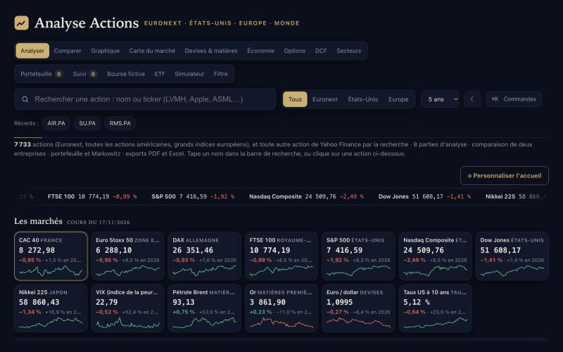
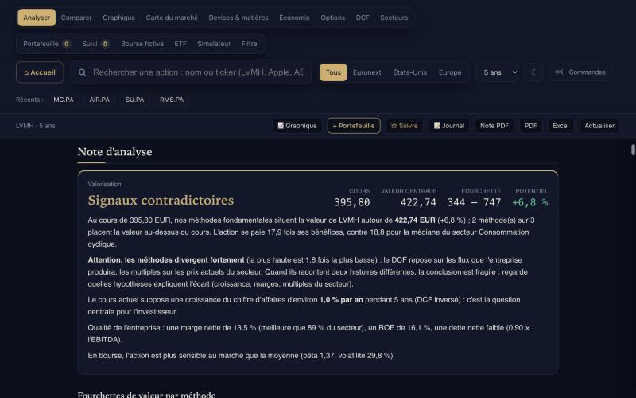
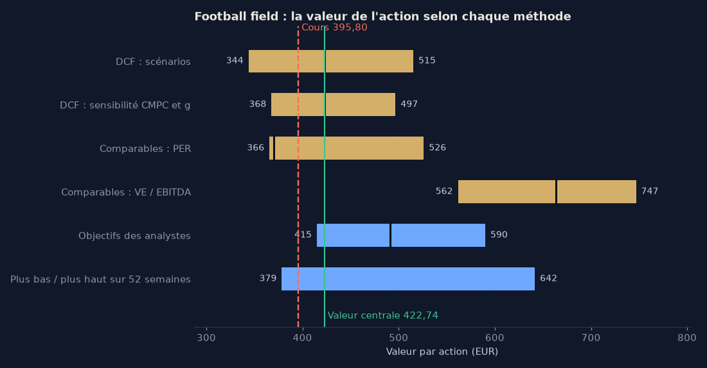
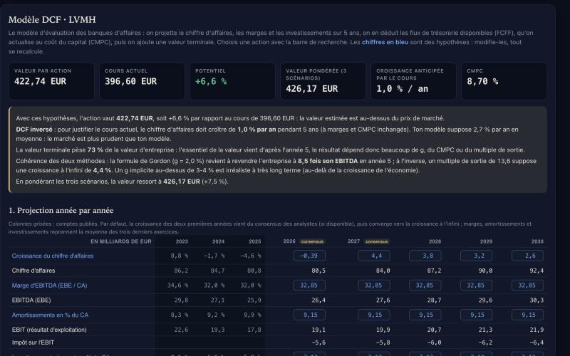

<div align="center">

# Analyse Actions

**Application d'analyse boursière pour débutants et étudiants en finance, écrite en Python.**

On tape le nom d'une action et on obtient un rapport complet **et expliqué** : performance, risque, analyse financière des comptes, valorisation par DCF et multiples, note d'analyse comme celles des banques.

[](https://github.com/simonkirch21/analyse-actions/releases/latest)
-black?logo=apple)


[**Télécharger**](https://github.com/simonkirch21/analyse-actions/releases/latest) · [**Page de présentation**](https://simonkirch21.github.io/analyse-actions/) · [Fonctionnalités](#fonctionnalités) · [Installer depuis le code](#installer-depuis-le-code) · [Architecture](#architecture)



</div>

> **Avertissement.** Outil pédagogique réalisé dans le cadre d'un Master 1 Finance. Les données proviennent de sources publiques gratuites (Yahoo Finance, FRED, BCE…) et peuvent être inexactes ou retardées. Rien dans cette application ne constitue un conseil en investissement.

---

## En bref

- **7 733 actions** proposées dans la recherche (toutes les places Euronext, toutes les actions cotées aux États-Unis, DAX, FTSE 100 et 250, SMI, IBEX 35, OMX Stockholm 30). Toute autre action cotée dans le monde est trouvée par une **recherche Yahoo Finance en direct**.
- **Un rapport en 8 parties** pour chaque action, avec pour chaque chiffre : « C'est quoi ? », comment le lire, et des repères.
- **Note d'analyse** façon banque d'affaires et **modèle DCF complet**, exportable en Excel avec formules.
- **Marchés, économie, portefeuille, bourse fictive, simulateur, filtre d'actions**, réunis dans une seule application.
- **Mac et Windows**, thème sombre, clair ou automatique, exports PDF et Excel.

## Télécharger

Sur la [page de présentation](https://simonkirch21.github.io/analyse-actions/) ou dans les [Releases](https://github.com/simonkirch21/analyse-actions/releases/latest) :

| Système | Fichier | Installation |
|---|---|---|
| **Mac** (puce Apple, macOS 12+) | `Analyse-Actions.dmg` | Glisser l'app dans Applications. Au premier lancement : clic droit → Ouvrir (l'app n'est pas signée par Apple). |
| **Windows 10 / 11** | `Analyse-Actions-Windows.zip` | Clic droit → Extraire tout, puis `Analyse Actions.exe`. Si Windows affiche « Windows a protégé votre ordinateur » : Informations complémentaires → Exécuter quand même. |

L'application est **autonome** : elle embarque Python et toutes ses bibliothèques. La version Windows est construite et vérifiée automatiquement sur une machine Windows de GitHub (`.github/workflows/windows.yml`) à chaque nouvelle Release.

---

## Fonctionnalités

### 1. Analyser une action

Chaque rapport commence par les **actualités récentes de l'entreprise** et par une **note d'analyse**, puis déroule 8 parties.

<table>
<tr>
<td width="50%"></td>
<td width="50%"></td>
</tr>
<tr>
<td align="center"><sub>Note d'analyse : verdict, thèse, chiffres clés</sub></td>
<td align="center"><sub>« Football field » : fourchettes de valeur par méthode</sub></td>
</tr>
</table>

**Note d'analyse**, comme celles des banques : verdict sur la valorisation, thèse rédigée, graphique *football field* (DCF, comparables PER et VE/EBITDA, objectifs des analystes, plus bas et plus haut sur 52 semaines), catalyseurs et risques. Les **chiffres clés sont cliquables** (« d'où vient ce chiffre ? ») : définition, calcul avec les chiffres de l'entreprise, repères et **rang dans le secteur** parmi environ 1 350 entreprises. Le bouton « Note PDF » produit la note sur une page, avec ses sources.

| Partie | Contenu | Notions |
|---|---|---|
| 1. Données | Téléchargement, rendements | prix ajustés, rendements simples et logarithmiques |
| 2. Performance | Rendement et risque | CAGR, volatilité, Sharpe, Sortino, drawdown, Calmar |
| 3. Marché | Comparaison à l'indice | CAPM, bêta, alpha (test t), R², tracking error, information ratio, Treynor |
| 4. Risque | Risque de perte | VaR et CVaR (historique, normale, Cornish-Fisher, Monte Carlo Student), Jarque-Bera, tests de Kupiec et Christoffersen |
| 5. Technique | Analyse technique | MM 50/200, RSI, Bollinger, MACD, backtest de 3 stratégies avec frais |
| 6. Simulation | Simulation et options | mouvement brownien géométrique, Black-Scholes et grecques, Monte Carlo risque-neutre, arbre binomial (option américaine) |
| 8. Analyse financière | Comptes de l'entreprise, selon le plan du cours de M1 | SIG, CAF, marges, effet ciseau, points morts, levier opérationnel ; bilan fonctionnel (FR, BFR, TN), BFR normatif, délais ; FTD, levier DFN/EBE, DSCR, ICR, gearing ; ROIC, ROCE, ROE, effet de levier et effet massue |
| 9. Valorisation | Valeur et scores | multiples (PER, VE/EBE, P/B, rendement du FCF), CMPC, DCF et sensibilités, consensus des analystes, Z-score d'Altman, F-score de Piotroski |

Chaque rapport contient aussi :
- **Publications de résultats** : BPA attendu et publié, surprise, réaction du cours le jour même comparée à l'indice, taux de publications au-dessus des attentes, le « paradoxe » (bons résultats mais cours en baisse), prochaine date.
- **Modèle à facteurs Fama-French** (5 facteurs et momentum, bibliothèque de Kenneth French) : l'« ADN de style » de l'action, alpha et R² comparés au CAPM.
- **Qualité des bénéfices** : conversion du bénéfice en trésorerie, accruals, M-score de Beneish détaillé, poids du goodwill, dilution ou rachats d'actions.
- **Dividendes** : historique, croissance sur 5 et 10 ans, années de hausse, taux de distribution, mois de versement, et 10 000 € investis il y a 10 ans avec ou sans réinvestissement.
- **Qui détient l'action ?** : dirigeants, fonds, transactions des dirigeants.
- **Concurrents** : 4 entreprises comparables (même industrie, taille proche), avec un bouton « Comparer ».
- **Exports** : PDF (rapport complet) et Excel (tous les chiffres, une feuille par partie, comptes bruts inclus).

**Comparer deux actions** : tous les indicateurs côte à côte, graphiques superposés et conclusion automatique.

### 2. Valoriser : le modèle DCF complet



Accessible par le bouton DCF, par la commande `DCF LVMH`, ou depuis la section Valorisation d'un rapport :
- projection sur 5 ans du chiffre d'affaires, de l'EBITDA, de l'impôt, des investissements et du BFR jusqu'au FCFF, **chaque hypothèse modifiable** (consensus des analystes pour la croissance à 1-2 ans) ;
- CMPC détaillé (bêta 5 ans ajusté de Blume) ;
- valeur terminale par **Gordon-Shapiro** et par **multiple de sortie** des concurrents, avec ce que chaque méthode suppose de l'autre ;
- pont valeur d'entreprise → capitaux propres → valeur par action diluée ;
- trois scénarios pondérés, **DCF inversé** (croissance anticipée par le cours), tables de sensibilité ;
- **export Excel avec formules**.

### 3. Suivre les marchés

- **Accueil, tableau de bord des marchés** : 9 indices (CAC 40, Euro Stoxx 50, DAX, FTSE 100, S&P 500, Nasdaq, Dow Jones, Nikkei, VIX) et 4 repères (pétrole, or, euro/dollar, taux US 10 ans), grand graphique interactif, valeurs phares, plus fortes hausses et baisses du jour, actions les plus volatiles, actualité économique (Le Monde, France 24, La Tribune, Investing). L'accueil est **personnalisable** : blocs à afficher, masquer et réordonner.
- **Carte du marché** : CAC 40, Euronext 100 ou S&P 500 ; taille = capitalisation, couleur = variation du jour.
- **Secteurs** : médianes, comparaison à l'ensemble, meilleures et moins bonnes entreprises sur 8 critères, filtre Europe ou S&P 500.
- **Filtre d'actions** : environ 1 350 entreprises (S&P 500 et Euronext) filtrées par PER, rendement, ROE, marge, dette nette / EBE, croissance, secteur ; profils prêts à l'emploi.
- **ETF** : frais (et leur coût sur 20 ans), contenu, secteurs, réplication, dividendes, éligibilité PEA, performance ; comparaison de deux ETF.
- **Options cotées** (actions américaines) : chaîne complète, volatilité implicite, sourire de volatilité, comparaison au prix Black-Scholes.
- **Devises et matières premières** : change, pétrole, gaz, métaux, céréales, café, cryptomonnaies.
- **Économie** : inflation, taux directeurs (BCE, Fed), taux à 10 ans (France, Allemagne, États-Unis), chômage, croissance du PIB, avec lecture automatique (taux réel, spread…) ; **courbe des taux** (États-Unis, zone euro) avec détection d'inversion ; **calendrier économique** de la semaine et de la suivante.

### 4. Investir et apprendre

- **Mon portefeuille** : performance en euros (devises converties), comparaison au MSCI World, corrélations, gain de diversification, contribution de chaque action au risque, **frontière efficiente de Markowitz**. Avec la date et le prix d'achat de chaque ligne : plus-values, dividendes reçus, impôt estimé (compte-titres ou PEA), test du rééquilibrage annuel, revenu de dividendes estimé et calendrier mois par mois.
- **Suivi et agenda** : liste de suivi avec alertes de prix (baisse du jour, plancher, plafond) et **alertes techniques** (passage de la moyenne 200 jours, croisement 50/200, RSI en survente ou surachat), envoyées en notification Mac ou Windows toutes les 15 minutes tant que l'app est ouverte ; agenda des résultats et dividendes.
- **Bourse fictive** : portefeuilles avec un capital virtuel, ordres au cours réel, frais de courtage, dividendes versés automatiquement, comparaison au CAC 40 et au MSCI World, classement. Un portefeuille peut démarrer dans le passé pour tester une stratégie.
- **Simulateur** : investissement mensuel sur un indice ou une action depuis une date, comparé à « tout investir au début » et à un livret ; rendement annuel (TRI), pire moment.
- **Journal d'investissement** : thèse, ce qui ferait changer d'avis, prix visés ; rappelé en tête du rapport.

### 5. Une interface pensée pour aller vite

- **Recherche** : suggestions dès les premières lettres ; ↑ ↓ et Entrée ; filtres Tous / Euronext / États-Unis / Europe ; choix de la période.
- **Barre de commandes** (⌘K) : `LVMH`, `G LVMH` (graphique), `COMP MC.PA KER.PA`, `DCF LVMH`, `CARTE SP`, `ECO`, `TAUX`, `CAL`, `FX`, `OPT AAPL`, `PF`, `SUIVRE AAPL`, `ACHAT 10 AIR.PA`, `VENTE 5 AIR.PA`, `SIM ^FCHI`, `ACCUEIL`…
- **Graphique interactif** : bougies, ligne ou zone, volumes, moyennes mobiles 20/50/200, Bollinger, RSI, zoom à la molette, comparaison de jusqu'à 5 actions en %.
- **Thème sombre, clair ou automatique** (qui suit le système), appliqué aussi aux rapports ; les PDF restent clairs pour l'impression.

---

## Installer depuis le code

Python 3.11 ou plus récent.

```bash
git clone https://github.com/simonkirch21/analyse-actions.git
cd analyse-actions
python3 -m venv .venv
.venv/bin/pip install -r requirements.txt     # Windows : .venv\Scripts\pip install -r requirements.txt

.venv/bin/python app.py                 # ouvre la fenêtre de l'application
.venv/bin/python app.py --navigateur    # dans le navigateur (utile pour déboguer)
.venv/bin/python app.py --serveur       # serveur seul : http://localhost:5055
```

### En ligne de commande

```bash
.venv/bin/python analyse_complete.py AAPL
```

| Option | Exemple | Effet |
|---|---|---|
| `--indice` | `--indice ^STOXX50E` | indice de référence (sinon choisi selon la place) |
| `--periode` | `--periode 10y` | `1y`, `2y`, `5y` (défaut), `10y`, `max` |
| `--sans-ouvrir` | | ne pas ouvrir le navigateur |

Le rapport est enregistré dans `rapports/TICKER_date.html`. Chaque partie peut aussi être lancée seule (`.venv/bin/python partie4_risque.py AAPL`), de même que `comparaison.py MC.PA KER.PA` et `portefeuille.py MC.PA:2000 AAPL:1500 TTE.PA:1000`.

Exemples de tickers Yahoo Finance : `AAPL` (Apple), `MC.PA` (LVMH), `TTE.PA` (TotalEnergies), `AIR.PA` (Airbus), `SAP.DE` (SAP), `^FCHI` (CAC 40), `^GSPC` (S&P 500).

### Construire l'application

| Commande | Résultat |
|---|---|
| `python construire_liste.py` | met à jour la liste des actions (`data/actions.json`) |
| `python creer_app.py` | installe l'application sur ce Mac, avec sa propre copie du code (macOS interdit aux applications de lire le Bureau sans autorisation) ; les erreurs éventuelles vont dans `app.log` |
| `python construire_dmg.py` | crée `distribution/Analyse-Actions.dmg` (environ 85 Mo, autonome, avec un `LISEZ-MOI.txt`) |
| `python construire_windows.py` | crée `distribution/Analyse-Actions-Windows.zip` (à lancer sous Windows ; fait automatiquement par GitHub Actions) |

Les données de l'utilisateur (portefeuille, suivi, rapports, journal) restent sur son ordinateur :

| Système | Dossier |
|---|---|
| Mac | `~/Library/Application Support/Analyse Actions` |
| Windows | `%APPDATA%\Analyse Actions` |
| Linux | `~/.local/share/Analyse Actions` |

Les rapports y sont enregistrés dans `rapports/`. En lançant directement les fichiers `.py`, tout reste dans le dossier du projet.

---

## Architecture

| Fichier | Rôle |
|---|---|
| `app.py` | serveur local (Flask) et fenêtre de l'application (pywebview) |
| `lanceur.py` | démarrage de l'application autonome, écran de chargement immédiat |
| `chemins.py` | emplacements des fichiers (application en lecture seule, données de l'utilisateur) |
| `interface/` | l'interface : `index.html`, `pro.js` et `pro.css` (commandes, graphique, carte, marchés, options, accueil), `dcf.js`, `outils2.js` |
| `analyse_complete.py` | assemblage du rapport HTML |
| `partie1_donnees.py` … `partie9_valorisation.py` | les 8 parties du rapport (voir le tableau plus haut) |
| `interpretation.py`, `interpretation_financiere.py`, `interpretation_valorisation.py` | explications pour débutants : résumé en langage courant, « C'est quoi ? », lecture des graphiques, repères (Banque de France 2022), calculateur DCF interactif |
| `note_analyse.py` | note d'analyse, football field, chiffres clés expliqués, note PDF |
| `dcf_avance.py` | modèle DCF complet et classeur Excel en formules |
| `resultats.py`, `facteurs.py`, `qualite.py`, `dividendes.py` | publications de résultats, Fama-French, qualité des bénéfices, dividendes |
| `comparaison.py`, `portefeuille.py`, `fictifs.py`, `simulateur.py` | comparaison, portefeuille (Markowitz), bourse fictive, investissement mensuel (TRI) |
| `marche.py`, `secteurs.py`, `base_fondamentale.py`, `etf.py`, `options_cotees.py` | tableau de bord, secteurs, ratios d'environ 1 350 entreprises (mise à jour quotidienne), ETF, options cotées |
| `macro.py`, `taux.py`, `calendrier.py`, `actualites.py` | économie (FRED, cache de 6 heures), courbe des taux, calendrier économique, actualités (RSS) |
| `suivi.py`, `journal.py` | liste de suivi, alertes, notifications ; journal d'investissement |
| `export.py` | exports PDF (xhtml2pdf) et Excel (openpyxl) |
| `construire_liste.py`, `creer_app.py`, `construire_dmg.py`, `construire_windows.py` | liste des actions et construction de l'application |

**Sources de données** : Yahoo Finance (cours, comptes, consensus, options), FRED (Eurostat, BCE, Fed, OCDE), BCE (courbe des taux), bibliothèque de Kenneth French (facteurs), Forex Factory (calendrier), Euronext et Wikipédia (listes d'actions), flux RSS de la presse économique.

---

## Hypothèses et limites

- Taux sans risque fixé à 3 % (`TAUX_SANS_RISQUE` dans `partie2_performance.py`).
- Les indices Yahoo (`^FCHI`, `^GSPC`) sont des indices de prix, sans dividendes, alors que les actions sont en dividendes réinvestis : l'alpha est légèrement surestimé.
- Les options de la partie 6 sont pricées sans dividende, avec la volatilité historique sur 1 an.
- Les projections Monte Carlo reposent sur la dérive passée : ce sont des illustrations, pas des prévisions.
- Analyse financière : comptes IFRS « par fonction » de Yahoo Finance (4 à 5 exercices). La valeur ajoutée, la production de l'exercice et les charges de personnel (présentation PCG « par nature ») ne sont pas disponibles. Point mort : coût des ventes supposé variable, autres charges fixes. Impôt normatif 25 %. Pas de notation ESG. Banques et assurances exclues.
- DCF simple de la partie 9 : flux de départ = moyenne des 3 derniers flux de trésorerie disponibles ; croissance = croissance passée du chiffre d'affaires (bornée entre 0 et 12 %) ; croissance à l'infini 2 % ; prime de risque 5,5 %. C'est un ordre de grandeur : le calculateur interactif et le modèle DCF complet permettent de tester d'autres hypothèses.
- Z-score d'Altman : version d'origine pour l'industrie, Z'' pour les services ; calibré sur des entreprises américaines, à interpréter avec prudence.
- Projet pédagogique : ce n'est pas un conseil d'investissement.

<div align="center">
<sub>Projet réalisé dans le cadre d'un Master 1 Finance · Voir aussi <a href="https://github.com/simonkirch21/quant-projects">quant-projects</a> (pricer d'options, backtester, modèle de risque, stratégie robuste)</sub>
</div>
